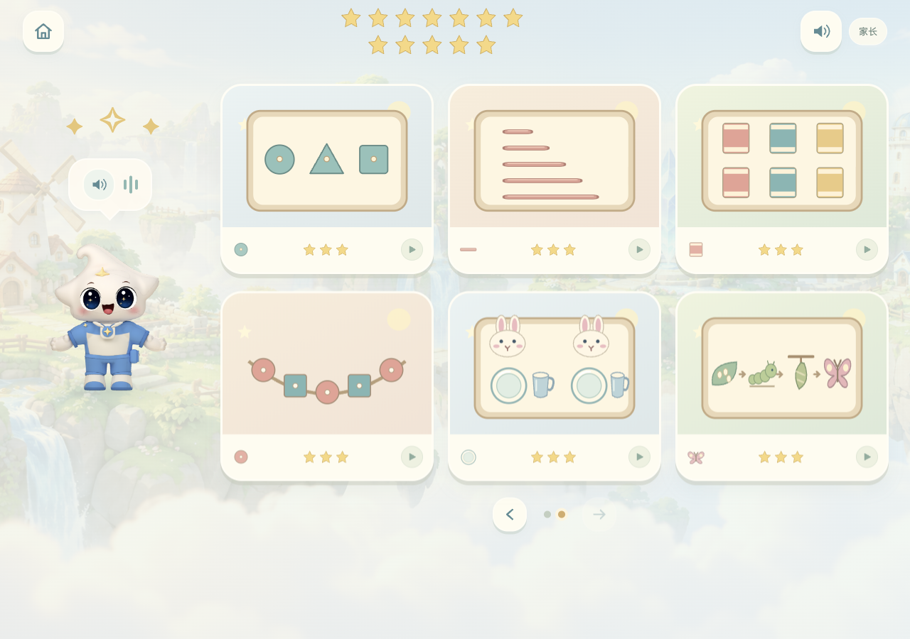
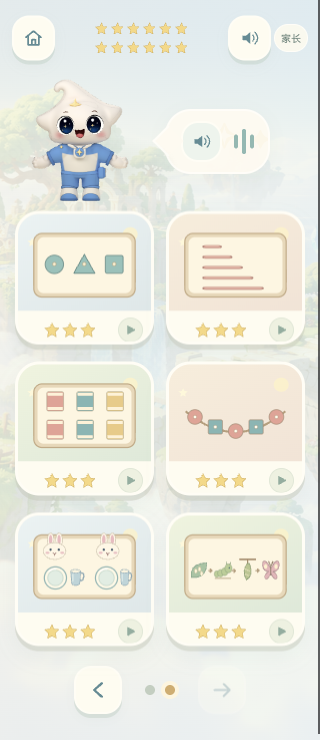
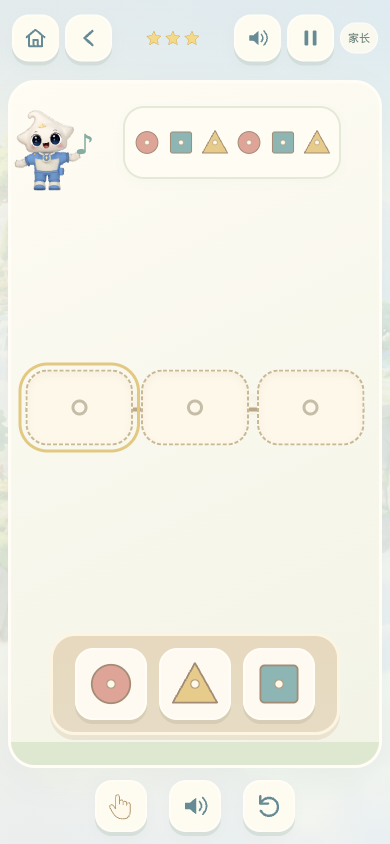

# 幼儿园 · 感官与发现活动架

后续更新：同日第二轮已扩展到 18 种场景、54 关，详见[动脑与表达活动架](kindergarten-playful.md)。本页保留第一轮 36 关版本的设计与验证记录。

2026-11-01：在原有六种生活场景、18 关基础上，增加六种活动、18 关，合计 **12 种场景、36 关**。本次为本地源码更新，未发布生产。

入口：`/arcade/kindergarten/index.html`，活动架下方的向右箭头。仍以每页六幅完整场景插画展示，保留浮岛背景、原有星宝模型、奶油色与木色玩具、图形目标、小手示范、点击/拖动双操作。新插画使用项目原生 SVG，不引入外部素材。

| 场景 | 第一关 | 第二关 | 第三关 | 学习重点 |
| --- | --- | --- | --- | --- |
| 形状找小窝 | 圆、方两种 | 三种形状 | 加入椭圆，共四种 | 同色嵌块隔离形状差异；用轮廓核对 |
| 长短小阶梯 | 三根木棒 | 四根木棒 | 五根木棒 | 同色、同厚度，从短到长逐一排列 |
| 色板找朋友 | 两种颜色 | 三种颜色 | 同一种绿色的三种深浅 | 视觉辨别、配对，保留参考色板供核对 |
| 规律小项链 | AB 交替 | AAB 重复 | ABC 循环 | 观察已有珠串，推断后续；空位不提前显示答案 |
| 小小餐桌长 | 两位朋友、各一盘 | 三位朋友、各一盘 | 三位朋友、各一盘一杯 | 一一对应；可任选尚未填好的相同餐具位置 |
| 故事排排队 | 种子、芽、花 | 打湿、涂皂搓洗、冲净、擦干 | 卵、毛毛虫、蛹、蝴蝶 | 生活步骤、自然观察与先后关系 |

每关的物品托盘重新打乱顺序。顺序活动逐步点亮当前空位；配对活动可以自由选择位置。正确放置后保留作品并标记完成，错放退回，不扣分、不倒计时。小手只演示，不写进度。每种活动可自由进入，优先继续尚未完成的关卡，全部完成后可从第一关重玩。

兼容旧的本机/账号命名空间进度：旧六种活动星星保留，新活动默认从零开始。未修改原有保存范围，也不计入小学课程积分。

新增 11 条短语音，并更新欢迎语，沿用现有星宝音色及生成工具。所有声音为本地 MP3；断网或静音时仍能看图与小手示范。故事三关有各自的语音，不依赖孩子阅读步骤文字。家长说明增加新活动、真实材料延伸，以及屏幕体验的边界。

## 设计参考与边界

借鉴 AMI 对精心准备的环境、简短示范、自主操作及自我检查的介绍，以及 AMS 对生活练习、感官辨别和具体材料的说明。这里是这些思路启发的数字练习，不是完整蒙特梭利课程或认证教具；保留项目既有星星反馈，没有把屏幕配对等同于真实触觉或精细动作训练。

- [AMI：Montessori Environments](https://montessori-ami.org/about-montessori/montessori-environments)
- [AMS：5 Core Components of Montessori Education](https://amshq.org/the-ams-difference/core-components-of-montessori/)

亲子延伸建议使用真实积木比较长短、一起摆餐桌、观察叶片颜色及植物生长、实践洗手步骤。家长根据孩子兴趣和准备程度陪伴，不把通关速度或星星数当成发展评估。

## 实现与验证

- `discovery.js`：活动内容和独立规则；`discovery-art.js`：玩具与场景插画；`discovery-view.js` / `discovery.css`：复用现有操作框架的界面。
- `npm run test:kindergarten`：原有与新增共 36 关规则；18 个新增关卡的 DOM 操作、演示不计分、错放、重复放置、暂停、重置、下一关、旧进度保留与继续未完成关卡；全部语音资源。
- 原有 `test-arcade.cjs` 与 `test-arcade-v2.cjs` 回归通过。
- 浏览器在 390px 与 320px 宽度下逐一完成 18 个新关卡，检查目标至少 44px、无横向溢出、无托盘或星宝遮挡；修复了 320px 下第五根木棒与托盘重叠。桌面布局也已检查。
- 浏览器实际验证错放不计分、拖拽与点选完成嵌板关卡；18 个新关卡的通关进度均可保存。尚未开展真实幼儿可用性测试。

