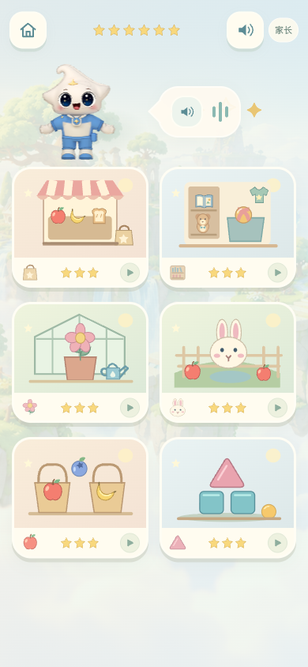
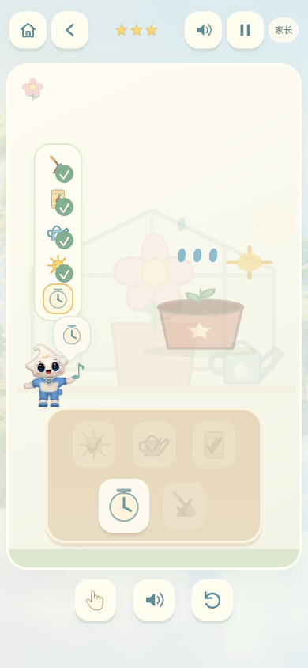

# 幼儿园生活小岛 · 2026-10-30

新增三个生活场景，与原有喂兔子、分水果、搭积木合计六种、18关：

- 帮忙买东西：按图片清单收集2—4件食物；相同物品须满足准确数量，清单外物品轻轻退回。点击直接装袋，也支持拖动。
- 收拾小房间：图画书进书架，皮球和小熊进玩具箱，上衣和袜子进衣柜；从两种增加到三种收纳处。柜内保留已收纳物品。
- 种一盆花：装土、播种、浇水；操作工具排列变化，完成步骤会打勾并提示下一步。花盆颜色随关卡变化。星宝说明动画压缩了生长过程，真实植物需要阳光与持续照顾。

2026-10-30 第二轮科学性优化：

- 购物改为“准备早餐”：目标同时显示1—3位小伙伴和食物清单，让孩子把“给谁准备”与所需数量联系起来；保留清单外干扰食物。
- 分类改为“分类小侦探”：三关分别按种类、大小、用途分类。第二关同一种水果同时出现大、小版本；第三关把食物和玩具分开，不再只是重复按水果名称配对。
- 种花从3步改为5步：装土、播种、适量浇水、阳光、等待。浇水后不再立即开花，先出现湿润土壤，再发芽，最后经过时间后开花。
- 新增阳光、时钟以及发芽阶段的项目原生SVG图形；星宝语音同步说明水、光照和时间，家长说明增加连续观察真实植物的建议。

继续保持无阅读门槛：玩法入口是完整场景插画，目标用实物小图，小手示范与短语音配合；购物和园艺允许直接点工具，精细拖动不是必需。错误不扣分、不倒计时。星宝位于独立区域，不遮挡入口与操作目标。家长说明提供真实生活延伸活动。

首页改为六张场景卡片与各自三颗进度星，保留既有星屿浮岛背景、星宝模型及柔和奶油/薄荷/木色体系。新物品和场景延展项目原生SVG玩具美术，未引入外部风格素材。

开源复用：继续使用仓库内 Matter.js（MIT）处理食物落入袋子、物品收纳后的物理反馈；继续使用 Kenney CC0 音效与已有 Three.js 星宝展示。新增短语音沿用星宝既有合成音色。浏览了 GCompris 的低龄图形互动理念作为设计参考，未复制其代码或素材。来源：

- https://github.com/liabru/matter-js （许可证已保存在 web/arcade/vendor/MATTER-LICENSE.txt）
- https://www.gcompris.net/index-en.html

验证：规则检查覆盖18关、重复物品、准确购物数量、按种类/大小/用途分类、植物五步顺序及全部语音文件；游乐实验室和336道图形活动原检查通过。浏览器逐一完成原18关并验证本地进度，第二轮另行完成五步种花与首关分类，进入大小分类验证大/小视觉规则；准备早餐、五步种花及大小分类在390px手机布局无横向溢出，星宝不遮挡操作目标。

仅更新幼儿园静态文件；其他正在进行的学段入口和人物源文件修改不纳入本次提交。

发布状态：源码已推送 GitHub，本地预览端口7468。阿里云控制台登录过期，SSH在握手前重置，正式站点暂未更新；待恢复登录后只发布幼儿园静态资源。
