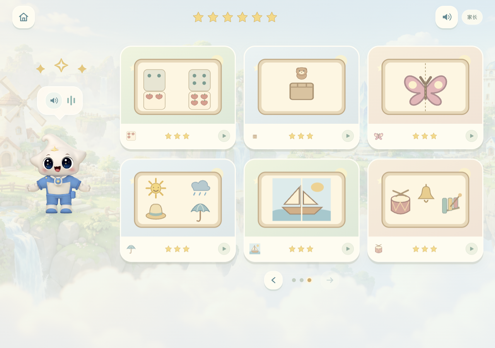
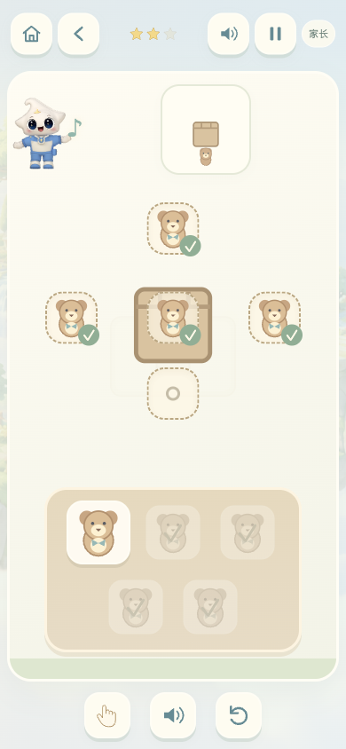
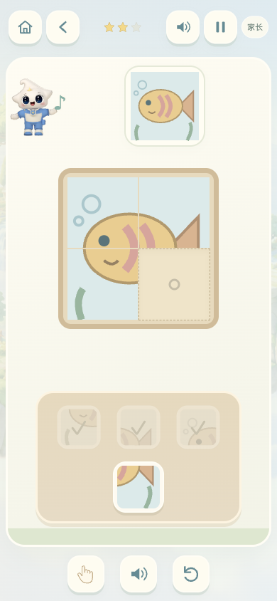

# 幼儿园 · 动脑与表达活动架

2026-11-01 第二轮扩充：从 36 关增加至 **54 关、18 种场景**。首页右箭头翻到第三页，可进入六种新活动，每种三关。当前为本地源码更新，未发布生产。

| 场景 | 三关内容 | 操作与学习形式 |
| --- | --- | --- |
| 点数小果园 | 1、2；1、3、4；2、3、4、5 | 数点阵，再选择同样数量的苹果果篮；不要求认识数字 |
| 小熊躲猫猫 | 上/里；下/左/右；五个位置综合 | 按当前样例放一只小熊，随后切换样例；不提前高亮正确位置 |
| 对称小工坊 | 两种、三种、四种图案 | 根据左半边的轮廓与花纹补右半边，拼成叶子、花朵、蝴蝶与风筝 |
| 晴雨小衣橱 | 晴雨；晴雨雪；四件用品 | 将遮阳帽、雨伞、雨靴、围巾与图中的天气对应；雨伞、雨靴可交换两个雨天位置 |
| 拼画小画家 | 两片帆船、三片房子、四片小鱼 | 对照完整图，观察局部线条与颜色，拼成完整画面 |
| 声音小乐队 | 鼓—铃；鼓—鼓—铃；铃—鼓—木琴—铃 | 点喇叭重听，按顺序反复点按乐器；同时用亮起的图卡示范，不评价速度与节拍准确率 |

## 体验与风格

沿用项目原生 SVG 玩具画风、奶油/薄荷/木色、原有浮岛与星宝模型。新图形由现有绘制方式延展，没有引入外部素材。欢迎语更新，新增六条玩法介绍及一条声音接龙重试语音，音色仍为已有星宝声音。

每架六张场景卡片。页数随活动数量计算，左右箭头逐页移动；顶部星星只展示当前活动架，避免关卡增加后挤压手机导航。原有 36 关及本机/账号命名空间进度均保留。

普通玩法继续支持拖拽和“先点物品、再点位置”。声音关卡直接点乐器，可重复使用同一乐器；点错保留已有正确声音，允许继续尝试。没有倒计时或扣分。

声音以浏览器原生音频合成，不增加网络依赖；声音关卡停播背景伴奏。暂停、重置、离开时取消示范队列；静音仍可看图卡依次亮起。快速操作后不会突然重启入场示范。小手和声音示范都不计入进度。

这些活动继续沿用[上一轮的设计思路与参考](kindergarten-discovery.md)，属于数字游戏中的数量、空间、整体/部分及声音顺序练习，不等同于完整蒙特梭利课程，不作为发展或听力测评。天气卡片表达本关的典型搭配，不代表某件用品只能在一种天气使用。家长可带孩子用真实物品数数、摆放玩具、拼纸画或轮流敲击声音。

## 验证

- `npm run test:kindergarten`：54 关规则，36 个探索类关卡完整 DOM 操作；旧进度、三页往返、重复乐器、雨天用品互换、方位/拼图错放、语音资源。
- 声音示范不计分；暂停、重置、退出取消尚未播放的声音；静音图示与快速点按不重启入场示范。
- `test-arcade.cjs`、`test-arcade-v2.cjs` 回归通过。
- 实际浏览器分别在 390×844、320×740、1280×650 下逐一完成 18 个新关卡；检查无横向溢出、目标至少 44px、无托盘或星宝遮挡，方位关卡不提前标出正确位置。较矮的电脑窗口允许页面滚动，保持操作区的完整尺寸。
- 真实点按完成“鼓—鼓—铃”，确认同一乐器可连续使用；重听示范、点错均不计分。
- 拼画实测错放不计分、拖拽与点选均能正确放置并通关。
- 尚未开展真实幼儿可用性测试。

